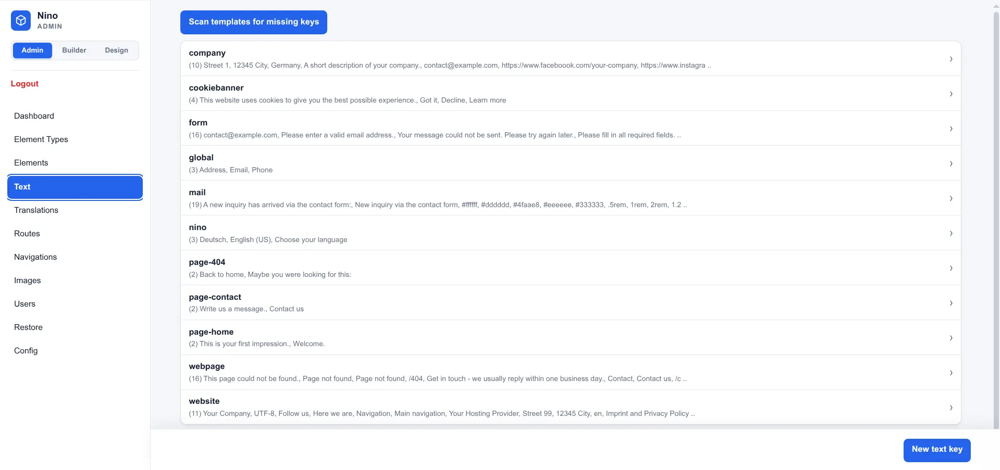
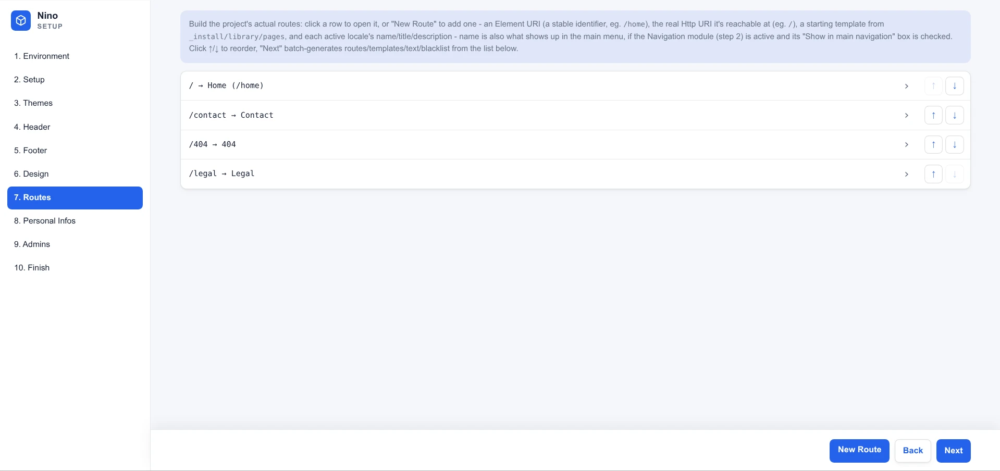
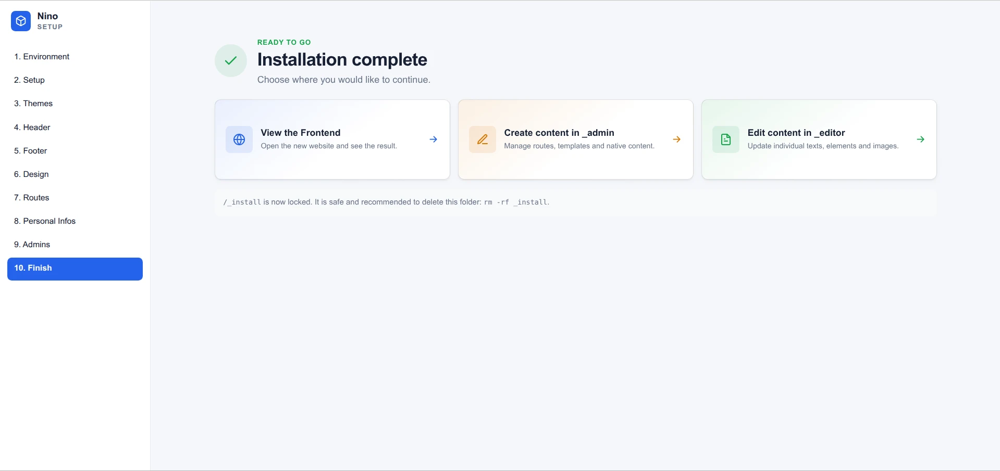

# Hi, I am Nino.

**Language:** English · [Deutsch](README.de.md)

**[Live Demo](https://demo.getnino.dev)**

## Build websites, not programs.

Nino is a lean foundation for modern PHP websites. It works entirely without a database or external packages and avoids unnecessary bloat. Developers retain control over the frontend, templates, and functionality; editors and site owners maintain content through a streamlined GUI.
Nino does not get lost in possibilities—it puts content on the web.

The entire project remains a readable set of files that can be versioned with Git and runs on standard PHP hosting. The initial setup takes only a few minutes and leaves a working foundation for further development. Developers can equip it with the tools they need and add custom functionality through a flexible callback system.
Multilingual content, posts and elements, forms, user permissions, and backups are already included; a newsletter, a search and further features come from the [dapeio/nino-features](https://github.com/dapeio/nino-features) catalogue.

## Why another CMS?

There are excellent PHP solutions for websites:
Mature systems such as WordPress cover almost every use case with themes, plugins, and a large community. This versatility is their strength—and also their greatest weakness.
Technical frameworks such as Laravel enable highly complex applications, but require a more extensive Composer-based environment and additional frontend tooling for conventional websites.
Pure HTML/CSS/JavaScript websites, on the other hand, are very lean but repeatedly need to reinvent editorial features.

**Nino occupies the space between them:** a practical foundation for dynamic websites. Developers can adapt projects quickly; site owners get a simple interface for essential content maintenance.

## Who is Nino for?

Nino is primarily intended for web developers and small agencies that build individual, conventional websites and may hand them over to third parties for content maintenance.

Solid HTML, CSS, and JavaScript skills plus basic PHP knowledge are useful for implementation. Custom modules, APIs, or databases can be integrated, but require correspondingly greater PHP experience.

## The pillars of Nino

### Frontend — simple, yet individual


The frontend is built from simple HTML-based templates, textfills, shortcodes, and recurring elements. Nino does not impose a ready-made page structure: the visible result remains an individual project.

The included design system, with its base components and modules, provides a quick starting point for conventional websites. Multilingual content, responsive design, performance, and security remain part of the project.

### `/_admin` — the workbench



One management interface with one login. Developers set the project up and build its structure and appearance here; editors maintain its content here. Every screen is a panel, grouped into **Content** (elements, texts, images, submissions, log), **Structure** (routes, navigations), **Features** (an installed feature's own panel, whatever group it names) and **System** (users and roles, languages and translations, backups, config, features); the shape of the content – element types, text keys, image slots – sits on tabs beside it. An account holds a role, a role one permission per panel or tab; the wizard writes Editor and Developer, and a panel an account may not use is not rendered.

The workbench provides full access for development, diagnostics and corrections, and a narrow, permission-controlled surface for daily editorial work. All changes can alternatively be made directly in the file system. `/_admin/recovery.php` is the way back in when the accounts themselves are broken.

#### The setup wizard — a quick start for the project

<a href="docs/assets/screenshots/_install1.webp" target="_blank">
  
</a>
<a href="docs/assets/screenshots/_install2.webp" target="_blank">
  
</a>

Every fresh checkout is configured through the wizard, which is what `/_admin` shows until it is done. It checks the environment, guides you through the languages (and the modules a project added itself, if any), copies the theme the base unit delivers along with the required assets, creates initial pages and basic information, creates the first developer accounts and sets the recovery password. Afterwards it locks itself out, and `_admin/install/` can be removed from a production delivery.

#### The Builder - a feature

The Builder composes a page template out of sections, rows, columns and components, and writes it back as the `page-*.tpl` file it read: the file is the truth, and what the Builder does not read it leaves byte for byte. Its panel sits in the Features group of the rail and is a workspace panel - the rail folds to its icons, and the preview, which is the editor with tools on every frame, takes the whole width. A component is a shortcode with a schema; the kernel's `Components` module is the registry the Builder reads, and features declare their own in their manifest.

## What Nino includes

* multilingual routing, texts, and content
* a dedicated template system with shortcodes and a clear separation of HTML and PHP
* one workbench for developers and editors, with roles, recovery and an optional Builder for `.tpl` files, a feature from the catalogue
* a file-based content model for textfills and recurring elements
* one fixed theme, asset bundling, and frontend base components
* forms, navigation, language selection, and image processing
* an imprint and a privacy policy as editable starting content, one element per section, in German and English, with the details of the company put in by placeholders
* installable features with a manifest, settings and versioned updates, switched on in the workbench - a newsletter and a search among those the [dapeio/nino-features](https://github.com/dapeio/nino-features) catalogue provides
* users, granular permissions, login protection, and activity logs
* automatic encrypted backups and restoration
* an integrated callback system for custom modules and integrations

**Important:** The imprint and privacy policy Nino ships are a starting point, not legal advice. They are not tailored to any particular website and have not been legally reviewed. The operator of a website is responsible for having them checked by a qualified person before publication and for adapting them: to what the website actually processes, to the operator's legal form, and to further mandatory details such as a commercial register entry, a VAT identification number or a person responsible for journalistic content. The project gives no warranty that the texts are correct, complete or up to date.

## Nino vs. WordPress, Laravel, Kirby, and Grav

None of these systems is inherently better than the others. They simply start from different premises and emphasize different priorities.

*As of August 2026*

| System | Approach | Technical foundation | Particularly suitable for |
| --- | --- | --- | --- |
| **Nino** | Compact website framework with its own editorial interface | PHP and file system; no database or external packages | Individual multilingual websites with a clear handover from developers to editors |
| **WordPress** | Universal content-oriented CMS with a large theme and plugin ecosystem | PHP with MySQL or MariaDB | Projects that benefit from ready-made extensions, themes, and a large community |
| **Laravel** | Full-stack framework for web applications | Composer-based PHP ecosystem | Custom applications, complex business logic, and scalable infrastructure |
| **Kirby** | Flexible flat-file CMS with a mature panel and plugin platform | File-based content and modern PHP | Custom websites with an established flat-file ecosystem |
| **Grav** | Open-source flat-file CMS with themes and plugins | Markdown, Twig, Symfony components, and a package manager | File- and Markdown-oriented websites with an open extension ecosystem |

Nino deliberately chooses a smaller scope: **no universal plugin ecosystem, no abstract application toolkit, and no database.**

In return, the stable kernel, fast setup, developer tools, and editorial interface form a coherent workflow specifically designed for individual websites.

By dispensing with an open plugin system and third-party runtime packages, Nino reduces its attack surface as well as update and supply-chain risks. Less third-party code and fewer interdependent versions make the installed codebase easier to understand and audit.

**This does not replace secure development, but it significantly reduces update and maintenance effort.**

## Quick Start

Nino requires **PHP 8.4 or newer** with the `gd`, `mbstring`, and `session` extensions plus the `PharData` class provided by `Phar`. It starts without a package manager or build step:

```bash
git clone https://github.com/dapeio/nino.git my-website
cd my-website
php -S 127.0.0.1:8000 router.php
```

Then open <http://127.0.0.1:8000/_admin>. `router.php` is the routing of PHP's built-in server and for local work only; a web server needs the configuration in [Deployment](docs/deployment.md#webroot-and-routing).

A fresh checkout is not a project yet. The setup wizard, which `/_admin` shows until it is done, creates `private/` and `public/` with everything in them. It has no access protection of its own and no account exists yet, so run it locally or in another protected environment. As long as it is not completed, you can return to an earlier step and apply it again. The six steps, each with its reference in the [Setup Wizard](docs/setup.md) manual:

| Step | Decision |
|---|---|
| [1. Environment](docs/setup.md#1-environment) | Are PHP, extensions, and write permissions ready for use? |
| [2. Languages](docs/setup.md#2-languages) | Which languages does the project require - and which modules, where the project added any of its own? |
| [3. Routes](docs/setup.md#3-routes) | Which first pages, public paths, and metadata are created? |
| [4. Personal Information](docs/setup.md#4-personal-information) | Which central company and website values are available as textfills? |
| [5. Accounts](docs/setup.md#5-accounts) | Which developer account(s) sign in to the workbench with full access? |
| [6. Finish](docs/setup.md#6-finish) | Which recovery password opens `/_admin/recovery.php` when the accounts are broken - and locks the wizard? |

The look is not among its questions: the base unit delivers one theme and the two frame templates it is drawn against ([The Look](docs/setup.md#the-look)). Editor accounts are created later, in the workbench's Users panel.

Then check the result. `/` delivers the configured website and `/_admin` opens the workbench with every panel for the root account. Look at every language and route, the navigation and the forms, and save a text and an image as a test. Once the wizard is complete, remove `_admin/install/` from a production delivery; everything it copied stays where it wrote it. The order and the checks are in [Verify the Result and Remove the Wizard](docs/setup.md#verify-the-result-and-remove-the-wizard).

## Philosophy and technology

Nino deliberately keeps its architecture small: a central `$appData` array carries the application state, `$request` remains responsible for the HTTP request and response, and callbacks connect the kernel, modules, and templates.

## Documentation

The manuals and the recipes are in English. The agent guide and the recipes are the working text of whoever extends Nino.

**Manuals**

* **[Developer Manual](docs/development.md):** how Nino runs - the request, routing, callbacks, rendering, modules, and security
* **[Setup Wizard](docs/setup.md):** the six steps, what they write, and the library format
* **[`/_admin` Workbench](docs/_admin.md):** roles and rights, recovery, and troubleshooting
* **[Features](docs/features.md):** installable packages - the panel, the manifest, the lifecycle, and the catalogue
* **[Deployment](docs/deployment.md):** web server, permissions, production settings, tests, and go-live
* **[Agent guide](AGENTS.md):** the rules every change keeps, and the method a change is made by

**Recipes** ([index](docs/recipes/README.md))

* **[Add a panel to the workbench](docs/recipes/admin-panel.md):** a new screen in `/_admin`
* **[Add a runtime module](docs/recipes/runtime-module.md):** PHP behavior at boot, a shortcode, an endpoint
* **[Add a component](docs/recipes/component.md):** a shortcode with a schema, or a stack that loops elements
* **[Add an installer module package](docs/recipes/installer-package.md):** a module the setup wizard can select
* **[Define Element types](docs/recipes/element-types.md):** repeated structured content
* **[Package a feature](docs/recipes/feature.md):** a module delivered as one directory with a manifest, settings, and a version

**Elsewhere**

* **[Builder](https://github.com/dapeio/nino-features/tree/main/features/Builder):** composing page templates from sections, columns and components - a feature from the catalogue [dapeio/nino-features](https://github.com/dapeio/nino-features), copied into `features/` and switched on in the Features panel; its manual is the one of its `feature.php`
* **[Feature catalogue](https://github.com/dapeio/nino-features):** the features Nino publishes - newsletter and search among them - installed from the Features panel or by copying a directory into `features/`
* **[Security Policy](https://github.com/dapeio/nino/blob/main/SECURITY.md):** security reports and supported versions
* **[Changelog](history/CHANGELOG.md):** the archive of the changes up to 1.7.0; from there the history is the git log

## Status and Security

Nino's kernel, frontend, workbench and project foundation are **released** - 1.3.0 is the first release. A feature carries its own maturity, which the Features panel shows as a badge beside its name.

Security fixes land directly on `main`; there is no separate LTS version yet.

Security issues should not be reported as public issues. Contact details and the currently supported version are listed in the [Security Policy](https://github.com/dapeio/nino/blob/main/SECURITY.md).

## License

[MIT](https://github.com/dapeio/nino/blob/main/LICENSE). The icons of the workbench come from
[Lucide](https://lucide.dev) (ISC, the ones taken over from Feather also MIT) and the typeface the base unit
delivers is [Open Sans](https://github.com/googlefonts/opensans) (SIL Open Font License 1.1); their notices are in
[THIRD-PARTY-NOTICES.md](https://github.com/dapeio/nino/blob/main/THIRD-PARTY-NOTICES.md).
